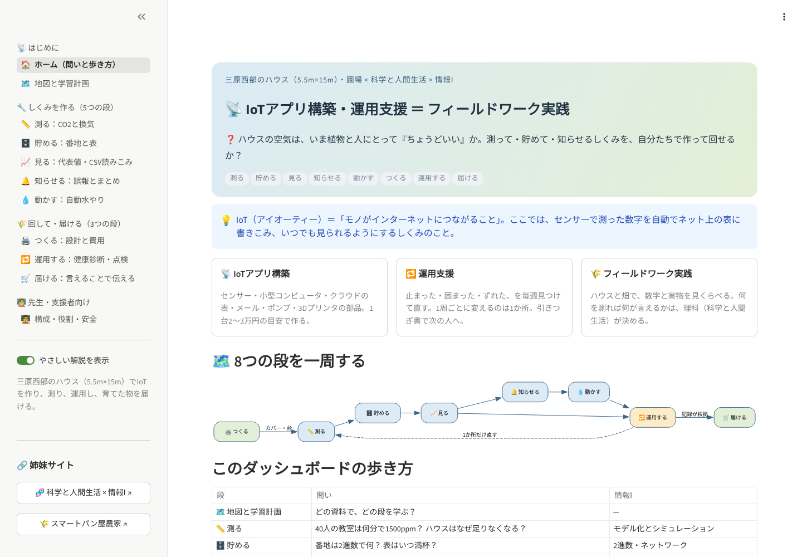
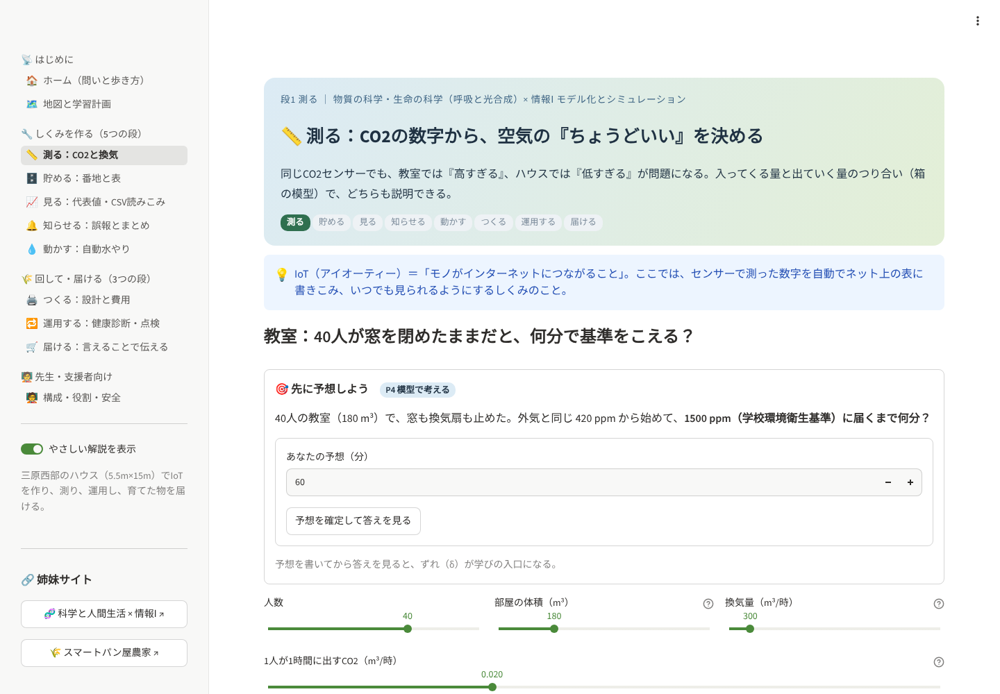
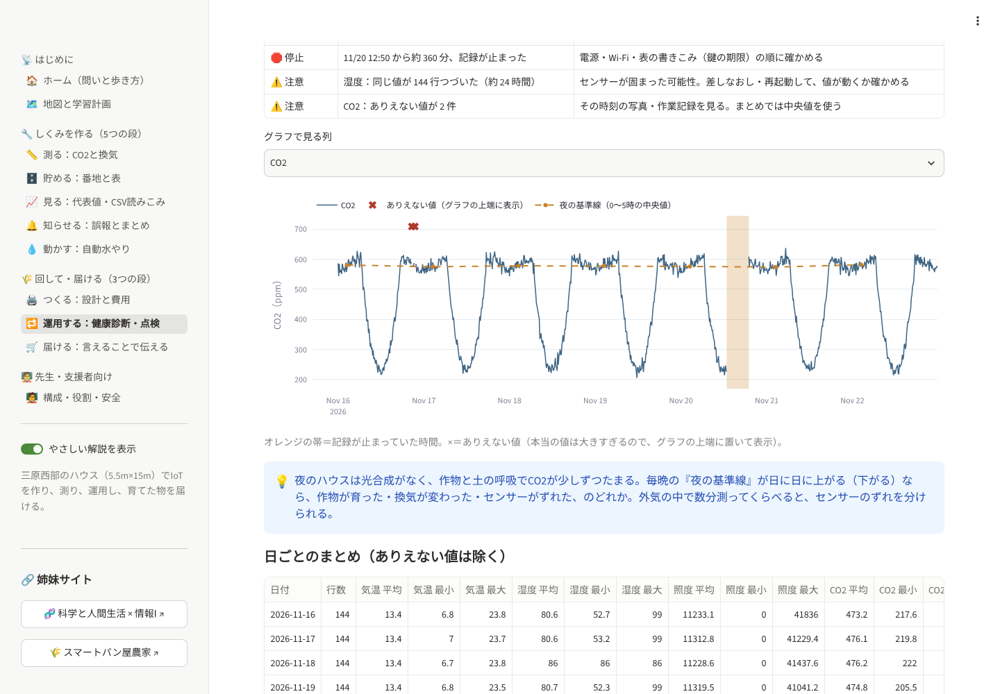
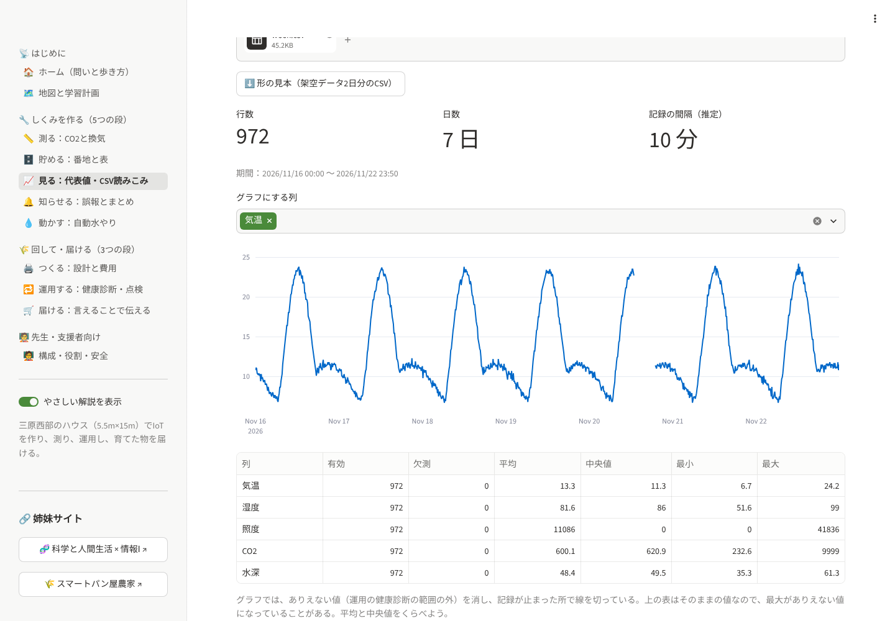

# 📡 IoTアプリ構築・運用支援 ＝ フィールドワーク実践 ― インタラクティブダッシュボード

三原西部のハウス（5.5m×15m）と圃場に、IoTを**作って・測って・運用して・届ける**までを一周するための教材ダッシュボードです（Streamlit）。

> ❓ **ハウスの空気は、いま植物と人にとって『ちょうどいい』か。測って・貯めて・知らせるしくみを、自分たちで作って回せるか？**



- **IoTアプリ構築**：センサー・小型コンピュータ・クラウドの表・メール・ポンプ・3Dプリンタの部品（1台2〜3万円の目安）
- **運用支援**：止まった・固まった・ずれた、を毎週見つけて直す。1周ごとに変えるのは1か所。引きつぎ書で次の人へ
- **フィールドワーク実践**：何を測れば何が言えるかを、理科（科学と人間生活）で決め、数字と実物を見くらべる

## 8つの段（左メニューの順）

| 段 | ページ | 問い | 情報Ⅰ |
|---|---|---|---|
| ─ | 🗺️ 地図と学習計画 | 資料10本で、どの段が手薄か？ | ─ |
| 1 | 📏 測る：CO2と換気 | 40人・換気ゼロの教室は何分で1500ppm？ ハウスは日中なぜ足りなくなる？ | モデル化とシミュレーション |
| 2 | 🗄️ 貯める：番地と表 | I2Cの番地を2進数で読む。表は何年で満杯？ | 2進数・ネットワーク |
| 3 | 📈 見る：代表値・CSV読みこみ | 外れ値・欠測で平均はどう動く？ **自分たちのCSVも読める** | データの活用 |
| 4 | 🔔 知らせる：誤報とまとめ | 誤報は1日何回？ 鳴った警報が本当である確率は？ まとめメールの文面 | 条件分岐・確率（ベイズ） |
| 5 | 💧 動かす：自動水やり | しきい値1本と2本（ヒステリシス）、入切の回数は？ | アルゴリズム・制御 |
| 6 | 🖨️ つくる：設計と費用 | 図面どおりだとなぜ入らない？ 3Dデータのライセンス、1台いくら？ | 知的財産権 |
| 7 | 🔁 運用する：健康診断・点検 | 1週間で、いつ止まり、何が固まり、何がずれた？ 公開前の点検・引きつぎ書 | 情報セキュリティ・保守 |
| 8 | 🛒 届ける：言えることで伝える | 記録から何を言える？ 『日本一』『栄養たっぷり』は言える？ | 情報デザイン |
| ─ | 🧑‍🏫 先生・支援者向け | 6回の構成・役割（得意×仕事）・安全・個人情報 | ─ |



### 🔁 運用する：1週間の健康診断



記録の**止まった時間（稼働率）・ありえない値・張りついた値・夜の基準線のずれ**を自動で見つけ、「どうする」まで表にします。
夜のハウスは光合成がなく、毎晩0〜5時の中央値（夜の基準線）が日ごとに動くなら、作物の生長・換気の変化・センサーのずれのどれかを疑います。
架空データの「故障」はスイッチで1つずつ入れたり外したりでき、**故障を1つ入れると、その故障だけが見つかる**ことをテストで確かめています。

### 📈 自分たちのCSVを読みこむ



表計算から書き出したCSV（UTF-8 / Shift_JIS、1MBまで）を読みこむと、「知らせる」「運用する」「届ける」でも同じデータを選べます。
時刻の列は自動で見つけます。列名を **気温・湿度・照度・CO2・水深** にしておくと、健康診断の範囲がそのまま使えます。
**読みこんだデータはこのセッションの中だけ**で使い、サーバーには保存しません。

## どのページでも同じ「考え方の型」

姉妹サイトと同じ **🔎 読解カード**（軸・単位・統制・言える／言えない）、**P1〜P5**（手順を回す・資料を読む・比較を疑う・模型で考える・知識で答える）、
**🎯 先に予想 → 答え → ずれ δ** を全ページで使います。

## 数値の出どころと扱い

| 値 | 扱い |
|---|---|
| CO2の基準：建築物衛生法 1000ppm 以下／学校環境衛生基準 1500ppm 以下が望ましい／1人あたり毎時30m³ | 公的な資料の値。**授業の前に最新の資料で確かめる** |
| 1人のCO2発生量 0.020m³/時・光合成の吸収速度・ハウスの平均の高さ2.5m・補償点50ppm | 幅を持たせた**仮定**。実測で置きかえる |
| 部品の値段・消費電力・電気代の単価 | **仮の値**（画面で書きかえられる） |
| 印刷で太る量0.1mm・はめ合い「ちょうど」0.1〜0.4mm | **仮定**。試し刷りで自分の機種の値を決める |
| センサーの1日・1週間のデータ | **説明用の架空データ**（乱数の種を固定） |
| 「ありえない値」の範囲・張りつきの長さ（2時間）・ずれの目安（15ppm/日） | 授業で話し合って決めなおす**仮の値** |
| 資料10本の時間・レクチャー数 | 作成者がまとめた資料に書かれていた値（未記入は0）。**講座名・講師名・事業所名・URLは載せていない**（テストで確認） |

## 🔗 姉妹サイト

| サイト | 役割 |
|---|---|
| 🧬 [科学と人間生活 × 情報Ⅰ](https://github.com/nayukaya3-cn/Science-and-Our-Daily-Life-dashboard) | 教室の事前学習（呼吸・光合成・発酵・プラスチック）。同じ読解カードとP1〜P5 |
| 🌾 [スマートパン屋農家](https://github.com/nayukaya3-cn/Smart-Bakery-Farmer_20260923) | 畑・パン工房の現場。育てた物を届ける先 |

## 手元で動かす

```bash
git clone https://github.com/nayukaya3-cn/IoT-Fieldwork-dashboard.git
cd IoT-Fieldwork-dashboard
python -m venv .venv && source .venv/bin/activate   # Windows: .venv\Scripts\activate
pip install -r requirements.txt
streamlit run app.py
```

## Streamlit Community Cloud で公開する

1. <https://share.streamlit.io/> → **Create app** → このリポジトリ・ブランチ `main`・Main file path に **`app.py`**
2. App URL を決めて **Deploy**
3. README 冒頭と、姉妹サイトの `sister_sites.py` にURLを書き足す

合言葉・鍵などの Secrets は**使いません**（設定不要）。

## ファイル構成

```
app.py           入口（左メニュー。ページを足すときは NAV に1行）
home.py          ホーム（問い・8つの段の図・歩き方）
iot_core.py      測る〜つくるの計算部品：換気の箱模型・番地・表の大きさ・誤報の確率・ベイズ・ポンプ・はめ合い・ライセンス・費用・公開前の点検
ops_core.py      運用・届けるの計算部品：1週間の架空データ・健康診断・日ごとのまとめ・まとめメール文面・CSV読みこみ・言える1文・言葉の点検
backbone.py      背骨（読解カード・P1〜P5・予想とずれ δ）
ui.py            画面の共通部品（見出し・段のバー・読解カード・予想・共通テスト型問題・データの選択）
guard.py         保護の部品（入力の安全化・CSVインジェクション対策）
sister_sites.py  姉妹サイトへのリンク
pages/           1_chizu 〜 10_kyoin
tests/           pytest（自己チェック・全ページの描画と操作・保護）
.streamlit/      公開用のセキュリティ設定
.github/         CI・脆弱性スキャン（pip-audit・bandit）・CodeQL・Dependabot・CODEOWNERS
```

## テスト

```bash
python iot_core.py && python ops_core.py && python backbone.py && python guard.py && python sister_sites.py
pytest -q
```

## プライバシー

入力・読みこんだCSVは閲覧中のセッションの中だけで使い、保存も送信もしません（ダウンロードは手元へのみ）。
名前・連絡先・写真の入力欄はありません。学習の記録を研究に使う場合は、実施前に保護者の同意と研究倫理審査が必要です。詳しくは [SECURITY.md](SECURITY.md)。
